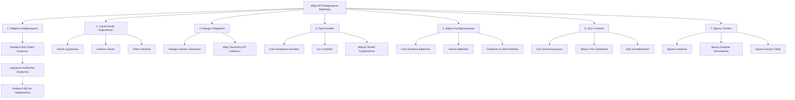
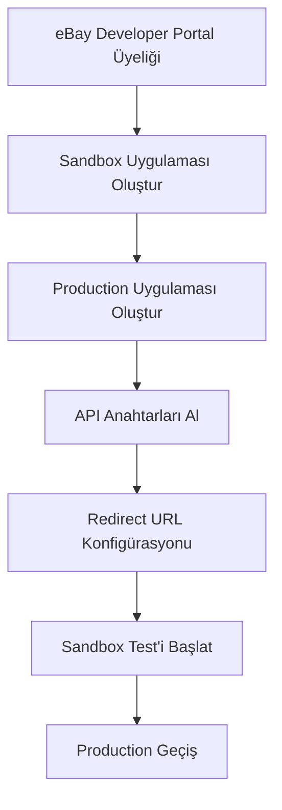
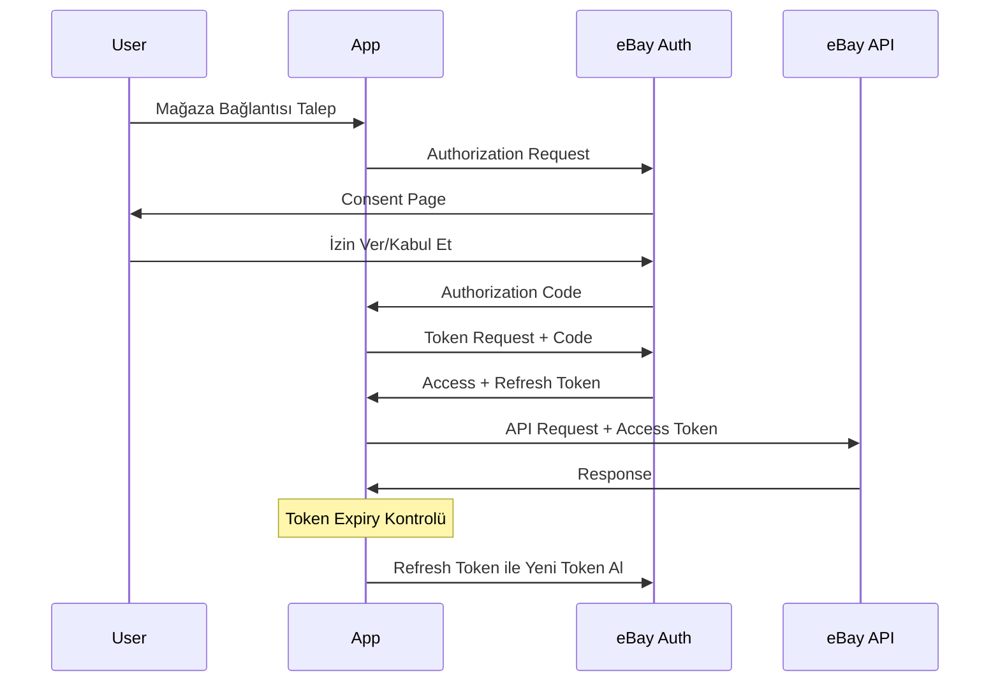
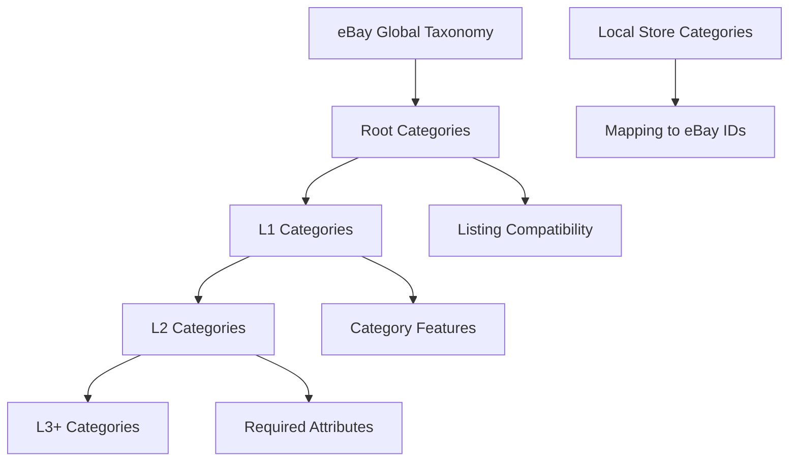
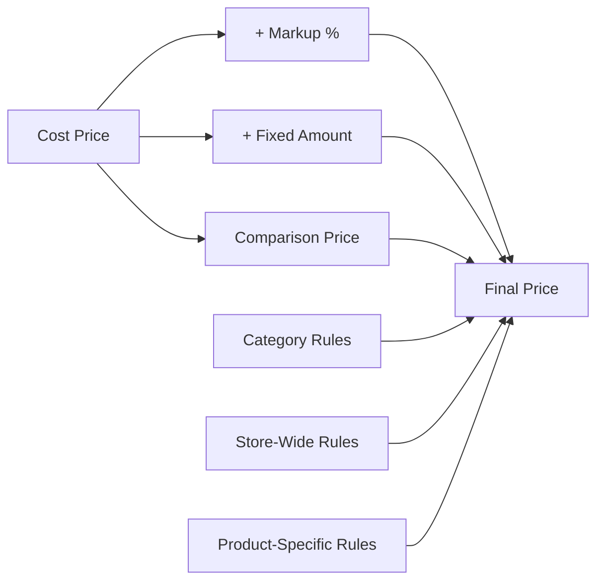
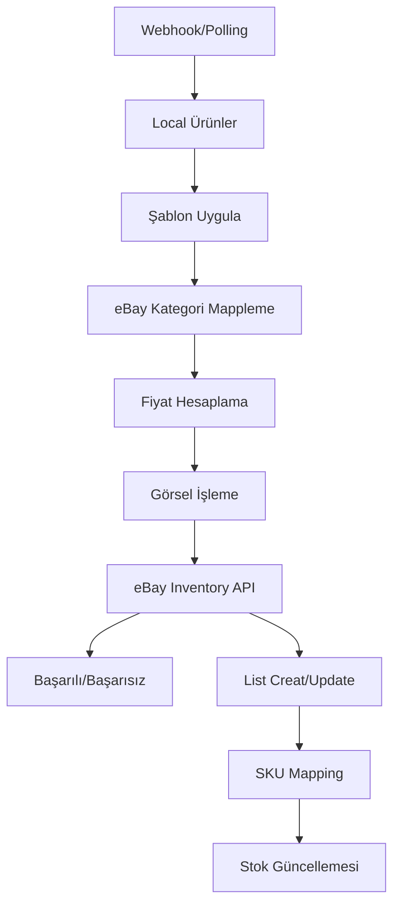
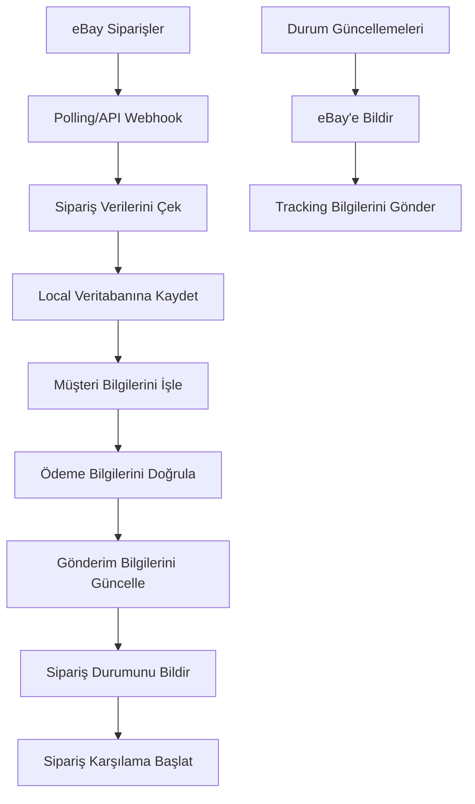

# eBay API Entegrasyonu Kılavuzu

## Giriş ve Genel Bakış

Bu kılavuz, e-ticaret websitenizdeki ürünleri ve siparişleri eBay platformuyla entegre etmeniz için kapsamlı bir rehber sunmaktadır. OAuth 2.0 tabanlı kimlik doğrulama, ürün yönetimi, fiyat kuralları, şablon konfigürasyonları ve sipariş işlemleri dahil olmak üzere tüm temel özellikleri kapsamaktadır.



## 1. Mağaza Konfigürasyonu ve Gerekli Policies

### eBay Developer Program Kurulumu



#### Sandbox ve Production Ortamları

- **Sandbox**: Geliştirme ve test amaçlı ortam
- **Production**: Canlı satış ortamı

#### API Anahtarları:
- `App ID (Client ID)`: Uygulama kimliği
- `Cert ID (Client Secret)`: Sertifika anahtarı
- `Dev ID`: Geliştirici kimliği

### Veri Tabanı Schema'sı

```sql
-- Mağazalar Tablosu
CREATE TABLE stores (
    id TEXT PRIMARY KEY,
    name TEXT NOT NULL,
    userId TEXT NOT NULL,
    ebayAppId TEXT,
    ebayCertId TEXT,
    ebayRuName TEXT,
    ebayToken TEXT,
    ebayTokenExpiry TIMESTAMP,
    description TEXT,
    sandboxMode BOOLEAN NOT NULL DEFAULT TRUE,
    isActive BOOLEAN NOT NULL DEFAULT TRUE,
    createdAt TIMESTAMP NOT NULL,
    updatedAt TIMESTAMP NOT NULL
);

-- Ürünler Tablosu
CREATE TABLE products (
    id TEXT PRIMARY KEY,
    storeId TEXT NOT NULL,
    sku TEXT NOT NULL,
    title TEXT NOT NULL,
    description TEXT,
    price DECIMAL(10,2) NOT NULL,
    costPrice DECIMAL(10,2),
    compareAtPrice DECIMAL(10,2),
    quantity INTEGER NOT NULL,
    trackQuantity BOOLEAN NOT NULL,
    condition TEXT,
    brand TEXT,
    categoryId TEXT,
    upc TEXT,
    ean TEXT,
    mpn TEXT,
    isActive BOOLEAN NOT NULL DEFAULT TRUE,
    createdAt TIMESTAMP NOT NULL,
    updatedAt TIMESTAMP NOT NULL
);

-- Kategoriler Tablosu (eBay ->
local mapping)
CREATE TABLE categories (
    id TEXT PRIMARY KEY,
    storeId TEXT NOT NULL,
    name TEXT NOT NULL,
    ebayCategoryId TEXT NOT NULL,
    ebayCategoryName TEXT,
    level INTEGER NOT NULL,
    parentId TEXT,
    isActive BOOLEAN NOT NULL DEFAULT TRUE,
    createdAt TIMESTAMP NOT NULL,
    updatedAt TIMESTAMP NOT NULL
);

-- Fiyat Kuralları
CREATE TABLE price_rules (
    id TEXT PRIMARY KEY,
    storeId TEXT NOT NULL,
    name TEXT NOT NULL,
    priceAdjustmentType TEXT NOT NULL,
    priceAdjustmentValue DECIMAL(10,2) NOT NULL,
    minPrice DECIMAL(10,2),
    maxPrice DECIMAL(10,2),
    categoryIds TEXT[],
    priority INTEGER NOT NULL,
    startDate TIMESTAMP,
    endDate TIMESTAMP,
    isActive BOOLEAN NOT NULL DEFAULT TRUE,
    createdAt TIMESTAMP NOT NULL,
    updatedAt TIMESTAMP NOT NULL
);

-- Ürün Liste Şablonları
CREATE TABLE listing_templates (
    id TEXT PRIMARY KEY,
    storeId TEXT NOT NULL,
    name TEXT NOT NULL,
    titleTemplate TEXT NOT NULL,
    descriptionTemplate TEXT NOT NULL,
    imageTemplate TEXT,
    shippingTemplate TEXT,
    condition TEXT NOT NULL,
    duration TEXT NOT NULL,
    listingType TEXT NOT NULL,
    returnsAccepted BOOLEAN NOT NULL,
    returnDays INTEGER NOT NULL,
    paymentMethods TEXT[],
    isDefault BOOLEAN NOT NULL DEFAULT FALSE,
    isActive BOOLEAN NOT NULL DEFAULT TRUE,
    createdAt TIMESTAMP NOT NULL,
    updatedAt TIMESTAMP NOT NULL
);
```

## 2. eBay API Authentication (OAuth 2.0)

### OAuth Akışı



### Token Yönetimi

```javascript
interface TokenManager {
  getAccessToken(): Promise<string>;
  refreshAccessToken(): Promise<string>;
  isTokenExpired(): boolean;
  storeTokens(tokens: { access_token: string, refresh_token?: string, expires_in: number });
}
```

### Ana Kimlik Doğrulama Türleri

1. **Application Token** (Client Credentials Grant)
   - Metadata erişimi için
   - Kategori bilgileri
   - API özelliklerinin sorgulanması

2. **User Token** (Authorization Code Grant)
   - Ürün yönetimi
   - Sipariş işlemleri
   - Stok güncellemeleri

### Rate Limits

- Client Credentials: 1,000 requests/day
- Authorization Code: 10,000 requests/day
- Refresh Token: 50,000 requests/day

## 3. eBay Category Mapping

### Kategori Sistemi



### Taxonomy API Kullanımı

```javascript
// Kategori ağacı alma
GET /commerce/taxonomy/v1/get_default_category_tree_id?marketplace_id=EBAY_US

// Kategori detayları
GET /commerce/taxonomy/v1/category_tree/{categoryTreeId}/get_category_subtree?category_id={categoryId}

// Kategori özellikler
GET /commerce/taxonomy/v1/category_tree/{categoryTreeId}/get_category_features?category_id={categoryId}
```

### Örnek Kod

```typescript
class CategoryManager {
  constructor(private ebayService: EbayService) {}

  async mapCategories(storeId: string) {
    // eBay kategorilerini al
    const ebayCategories = await this.ebayService.getCategories();

    // Local kategorilere map et
    const categoryMappings = this.createMappings(ebayCategories);

    // Veritabanına kaydet
    await this.saveCategoryMappings(storeId, categoryMappings);

    return categoryMappings;
  }

  private createMappings(ebayCategories: any[]) {
    // Kategori mapping mantığı
    return ebayCategories.map(ebayCat => ({
      localCategoryId: this.findLocalCategory(ebayCat.name),
      ebayCategoryId: ebayCat.categoryId,
      level: ebayCat.level
    }));
  }
}
```

## 4. eBay Price Rules ve Price Increment Konfigürasyonu

### Fiyat Hesaplama Mimarisi



### Price Rule Types

1. **Percentage Markup**: Maliyet üzerine yüzde artır
2. **Fixed Amount**: Sabit miktar ekle
3. **Comparison Pricing**: Rakip fiyatlarından düşük olma
4. **Category-based**: Kategori bazlı kurallar

### Price Adjustment Types

```typescript
enum PriceAdjustmentType {
  PERCENTAGE = 'PERCENTAGE',
  FIXED_AMOUNT = 'FIXED_AMOUNT',
  COMPETITOR_BASED = 'COMPETITOR_BASED'
}

interface PriceRule {
  id: string;
  name: string;
  adjustmentType: PriceAdjustmentType;
  adjustmentValue: number;
  minConstraints?: {
    price?: number;
    quantity?: number;
  };
  maxConstraints?: {
    price?: number;
    quantity?: number;
  };
  categoryFilter?: string[];
  priority: number;
  startDate?: Date;
  endDate?: Date;
}
```

### Örnek Uygulama

```typescript
class PriceCalculator {
  calculateSellingPrice(
    product: Product,
    rules: PriceRule[],
    basePrice: number
  ): number {
    let calculatedPrice = basePrice;

    // Öncelik sırasına göre kuralları uygula
    const applicableRules = this.filterRules(rules, product);

    for (const rule of applicableRules.sort((a, b) => a.priority - b.priority)) {
      calculatedPrice = this.applyRule(calculatedPrice, rule);
    }

    return Math.round(calculatedPrice * 100) / 100; // 2 decimal
  }

  private applyRule(price: number, rule: PriceRule): number {
    switch (rule.adjustmentType) {
      case PriceAdjustmentType.PERCENTAGE:
        return price * (1 + rule.adjustmentValue / 100);
      case PriceAdjustmentType.FIXED_AMOUNT:
        return price + rule.adjustmentValue;
      default:
        return price;
    }
  }
}
```

## 5. eBay Listing Template Configs

### Şablon Bilesenleri

1. **Title Template**: Ürün başlığı formatı
2. **Description Template**: Açıklama formatı
3. **Image Template**: Görsel düzenleme kuralları
4. **Shipping Template**: Gönderim ayarları
5. **Return Policy**: İade politikası

### Template Variables

```
{{title}} - Ürün adı
{{brand}} - Marka
{{model}} - Model
{{condition}} - Ürün durumu
{{description}} - Açıklama
{{price}} - Fiyat
{{sku}} - Stok kodu
```

### Örnek Şablon

```json
{
  "titleTemplate": "{{brand}} {{title}} - {{condition}} - {{sku}}",
  "descriptionTemplate": "<h2>{{title}}</h2><p>{{description}}</p><p>Brand: {{brand}}</p><p>Condition: {{condition}}</p>",
  "shippingTemplate": {
    "shippingService": "USPSPriority",
    "shippingCost": 5.99,
    "freeShipping": true
  },
  "returnPolicy": {
    "returnsAccepted": true,
    "returnPeriod": 30,
    "returnShippingCostPayer": "BUYER"
  }
}
```

```typescript
class ListingTemplateManager {
  applyTemplate(product: Product, template: ListingTemplate): EbayListing {
    return {
      title: this.renderTemplate(template.titleTemplate, product),
      description: this.renderTemplate(template.descriptionTemplate, product),
      shipping: template.shippingTemplate,
      returns: {
        returnsAccepted: template.returnsAccepted,
        refundOption: template.returnDays > 0 ? 'MONEY_BACK' : 'NOT_ACCEPTED',
        returnsWithinOption: `DAYS_${template.returnDays}`,
        shippingCostPaidByOption: 'BUYER'
      },
      condition: template.condition,
      duration: template.duration,
      listingType: template.listingType
    };
  }

  private renderTemplate(template: string, product: Product): string {
    return template
      .replace(/{{title}}/g, product.title)
      .replace(/{{brand}}/g, product.brand || '')
      .replace(/{{sku}}/g, product.sku)
      .replace(/{{condition}}/g, product.condition || 'New')
      .replace(/{{description}}/g, product.description || '');
  }
}
```

## 6. eBay Product Manual Sync, Push ve List

### Ürün Senkronizasyonu Akışı



### Inventory API İşlemleri

1. **Create Inventory Item**
   ```http
   PUT /sell/inventory/v1/inventory_item/{sku}
   ```

2. **Create Offer**
   ```http
   POST /sell/inventory/v1/offer
   ```

3. **Publish Offer**
   ```http
   POST /sell/inventory/v1/offer/{offerId}/publish
   ```

### Ürün Push Örneği

```typescript
class ProductSynchronizationService {
  async syncProductToEbay(productId: string, storeId: string) {
    // Ürün bilgilerini al
    const product = await this.getProduct(productId);

    // Şablon uygula
    const template = await this.getListingTemplate(storeId);
    const listing = await this.templateManager.applyTemplate(product, template);

    // Kategori mappleme
    const categoryMapping = await this.getCategoryMapping(product.categoryId);
    listing.categoryId = categoryMapping.ebayCategoryId;

    // Fiyat hesaplama
    const priceRules = await this.getActivePriceRules(storeId, product.categoryId);
    listing.price = this.priceCalculator.calculateSellingPrice(product, priceRules, product.price);

    // eBay'e gönder
    const inventoryResult = await this.ebayInventoryApi.createInventoryItem(product.sku, listing);
    const offerResult = await this.ebayInventoryApi.createOffer(product.sku, listing);
    const publishResult = await this.ebayInventoryApi.publishOffer(offerResult.offerId);

    // Veritabanını güncelle
    await this.updateProductSyncStatus(productId, publishResult.listingId);

    return publishResult;
  }

  async updateStock(sku: string, quantity: number, storeId: string) {
    await this.ebayInventoryApi.updateInventoryItemQuantity(sku, quantity);
    await this.logStockUpdate(sku, quantity, storeId);
  }
}
```

## 7. Order Listing ve Viewing Detayları

### Sipariş Yönetimi Akışı



### Fulfillment API Kullanımı

1. **Siparişleri Listele**
   ```http
   GET /sell/fulfillment/v1/order?filter=creationdate:[20230101..20231231]
   ```

2. **Sipariş Detayları**
   ```http
   GET /sell/fulfillment/v1/order/{orderId}
   ```

3. **Gönderi Bilgileri**
   ```http
   POST /sell/fulfillment/v1/order/{orderId}/shipping_fulfillment
   ```

### Order Processing Service

```typescript
class OrderManagementService {
  async fetchOrders(storeId: string, lastSyncDate?: Date) {
    const token = await this.tokenManager.getAccessToken(storeId);

    const orders = await this.ebayFulfillmentApi.getOrders({
      filter: {
        creationdate: this.buildDateFilter(lastSyncDate)
      }
    }, token);

    const processedOrders = [];
    for (const order of orders) {
      const processedOrder = await this.processOrder(order, storeId);
      processedOrders.push(processedOrder);
    }

    await this.saveOrders(processedOrders, storeId);
    return processedOrders;
  }

  private async processOrder(ebayOrder: any, storeId: string) {
    return {
      id: ebayOrder.orderId,
      storeId,
      customer: this.extractCustomer(ebayOrder),
      items: ebayOrder.lineItems.map(item => this.extractOrderItem(item)),
      totals: this.extractTotals(ebayOrder),
      shipping: this.extractShipping(ebayOrder),
      status: this.mapOrderStatus(ebayOrder.orderFulfillmentStatus),
      createdAt: new Date(ebayOrder.creationDate),
      updatedAt: new Date()
    };
  }

  async updateTracking(orderId: string, trackingNumber: string, carrier: string) {
    const fulfillment = {
      lineItems: [{
        lineItemId: orderId,
        quantity: 1
      }],
      shippedDate: new Date().toISOString(),
      shippingCarrierCode: carrier,
      trackingNumber
    };

    await this.ebayFulfillmentApi.createShippingFulfillment(orderId, fulfillment);
  }

  private extractCustomer(ebayOrder: any) {
    const buyer = ebayOrder.buyer;
    return {
      email: buyer.email || '',
      name: `${buyer.name?.firstName || ''} ${buyer.name?.lastName || ''}`.trim(),
      phone: ''
    };
  }
}
```

## Hata Yönetimi ve Best Practices

### Error Handling Patterns

```typescript
class EbayApiErrorHandler {
  handleError(error: any, operation: string) {
    switch (error.response?.status) {
      case 401:
        throw new Error('Authentication failed - refresh token');
      case 403:
        throw new Error('Insufficient permissions');
      case 404:
        throw new Error('Resource not found');
      case 429:
        throw new Error('Rate limit exceeded - retry later');
      default:
        this.logError(error, operation);
        throw new Error(`eBay API Error: ${error.message}`);
    }
  }

  async retryWithBackoff<T>(
    operation: () => Promise<T>,
    maxRetries = 3
  ): Promise<T> {
    let attempt = 0;
    while (attempt < maxRetries) {
      try {
        return await operation();
      } catch (error) {
        if (this.isRetryableError(error)) {
          attempt++;
          await this.delay(Math.pow(2, attempt) * 1000);
          continue;
        }
        throw error;
      }
    }
    throw new Error('Max retries exceeded');
  }
}
```

### Monitoring ve Logging

```typescript
interface ApiLog {
  operation: string;
  requestId: string;
  requestPayload: any;
  responsePayload?: any;
  error?: string;
  duration: number;
  timestamp: Date;
}
```

## Sonuç ve İleri Adımlar

Bu kılavuz, eBay API entegrasyonunun temel bileşenlerini kapsamaktadır. Örnek proje kodları ile birlikte gerçek uygulama için hazır bir başlangıç noktası sunmaktadır.

### Sıradaki Adımlar:

1. **Örnek projeyi çalıştırın**: `/code` dizinindeki örnek uygulamayı inceleyin
2. **Sandbox testi yapın**: Geliştirme ortamında testlerinizi gerçekleştirin
3. **Production geçişi**: Canlı ortama geçerken dikkatli olun
4. **Monitoring kurun**: API çağrılarınızı izleyin ve hataları takip edin
5. **Güvenlik uygulanın**: Token'ları güvenli bir şekilde yönetin

### Faydalı Kaynaklar

- [eBay Developer Portal](https://developer.ebay.com/)
- [API Documentation](https://developer.ebay.com/api-docs)
- [Sandbox Environment](https://developer.ebay.com/sandbox)
- [API Status Dashboard](https://developer.ebay.com/support/api-status)

---

*Bu kılavuz, eBay API'lerinin en güncel sürümleri baz alınarak hazırlanmıştır. API değişikliklerini takip etmek için eBay Developer Program duyurularını takip edin.*
